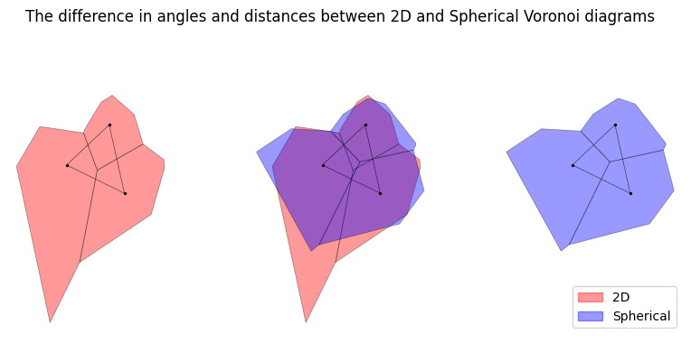

JLPTデータの担当者へ、2024年からは"Qatar"|カタールが"Catarrh"と間違って入力されてる。それに、"Pittsburg"ではなく"Pittsburgh"。  


The Census Bureaus "at home language speaker" data paints an incomplete picture of language speakers. Thus, I decided to go through JLPT test data to get a better picture of the number of Japanese language learners throughout the US.  
So I parsed through all the historical data that is stored in the superior data format of ... pdf ... wait. pls no.  
  
2010-2011 data is not included due to a PDF being rasterized, and the formatting being different in 2010.  
  
### Test Locations (USA)  
Here is a voronoi diagram of the "area" around each test site. It should be noted that this diagram is a 2d representation and is distorted by latitude and longitude. The real "area" around each test site is shorter and wider.  

:::{.column-margin}  
{.lightbox}
:::

```{python}
import unicodedata
import numpy as np
import pandas as pd
import geopandas as gpd
import folium
import os
from pathlib import Path
import re
from ipyleaflet import Map, WidgetControl, GeoJSON
import ipywidgets as widgets
import json
import matplotlib.pyplot as plt
import matplotlib
import matplotlib.patheffects as path_effects
from folium.plugins import GroupedLayerControl

tl = gpd.read_file("../../jplang/jlpt/timeline.gpkg")
tp = gpd.read_file("../../jplang/jlpt/tlpoly.gpkg")
yrs = sorted(tl.yr.unique(), reverse=True)
m = folium.Map(location=[38, -96], zoom_start=4,scrollWheelZoom=False)

groups = []
for yr in yrs:
    grp = folium.FeatureGroup(name=str(int(yr)), show=(yr == 2026))
    if not tp[tp.yr == yr].empty:
        grp.add_child(folium.GeoJson(json.loads(tp[tp.yr == yr].to_json()),
            style_function=lambda x: {"color": "gray", "weight": 2, "fillColor": "lightblue", "fillOpacity": 0.2},zoom_on_click=True
        ))
    if not tl[tl.yr == yr].empty:
        grp.add_child(folium.GeoJson(json.loads(tl[tl.yr == yr].to_json()),
        marker=folium.CircleMarker(radius=4, color="red", fill=True,fill_opacity=0.6,opacity=1, weight=1),
        ))
    m.add_child(grp)
    groups.append(grp)

folium.Control("Scale", position="bottomleft").add_to(m)
GroupedLayerControl(groups={"Year": groups}, exclusive_groups=True).add_to(m)

m
```  
\*\*1. There was no JLPT test in 2020 (in the US)\*\*  
\*\*2. Honolulu is also a test site, but left out\*\*  

---  

### # of Test Takers (N1, N2)  
On the JLPT site they display a [graph of total applicants increasing](https://www.jlpt.jp/e/statistics/index.html), but lets see how the trend holds for test takers of N1,N2.  
```{python}  
ax = pd.read_parquet("../../jplang/jlpt/n12.parquet").n12.plot.bar(title="Global Test Takers of N1 or N2", zorder=99, ylim=(0,700000))
ax.text(0.5, 0.4, "p i c k p j", style="oblique", transform=ax.transAxes,
    fontsize=55, family="monospace", fontstretch=0, 
    ha="center", va="center", rotation=0, zorder=100).set_path_effects([
    path_effects.PathPatchEffect(offset=(4, -4), hatch="xOx", edgecolor=(0.2,0.3,0.7,0.5), facecolor=(0.8,0.8,0.8,0.15))])
ax.grid(axis="y")
```  
An increase from 587k (2019) to 660k (2025) [+12.4%] is a more modest increase compared to that of total applicants. The number of people who passed increased, but is similarly dampered only going from 197k (2019) to 210k (2025) [+6.9%]. Although, I'm quite interested to see how the recent changes to immigration laws will impact these figures for 2026 and beyond.  

Further, since it is of interest to me, lets see what the trend looks like for US test takers (of N1, N2).  
```{python}
ax = pd.read_parquet("../../jplang/jlpt/usa.parquet").n12.plot.bar(title="US Test Takers of N1 or N2", zorder=99, ylim=(0,3000))
ax.text(0.5, 0.4, "p i c k p j", style="oblique", transform=ax.transAxes,
    fontsize=55, family="monospace", fontstretch=0, 
    ha="center", va="center", rotation=0, zorder=100).set_path_effects([
    path_effects.PathPatchEffect(offset=(4, -4), hatch="xOx", edgecolor=(0.2,0.3,0.7,0.5), facecolor=(0.8,0.8,0.8,0.15))])
ax.grid(axis="y")
```  
A 12% increase between 2018 and 2025. Somewhat similar, but trailing behind global trends.  

One thing to consider with all this data is we do not know the pass rates / retake rates (by country). Thus not much can be understood from the "area under the curve".  

### Proportion of Tests by Country  
Here is the proportion of tests taken by country
```{python}
testprop = pd.read_parquet("../../jplang/jlpt/testprop.parquet")
testprop = testprop.sort_values(by="n2", ascending=True)
ax = testprop.div(testprop.sum(axis=1), axis=0).plot.barh(stacked=True, figsize=(5, 18), title="Proportion of Tests Taken by\nCountry from 2012 to 2025\nRanked by N2 Tests Taken\n(Nominal)")
plt.xlabel("Proportion")
ax.tick_params(axis="x", bottom=True, top=True, labelbottom=True, labeltop=True)
ax.grid(axis="x", c="Black", alpha=0.5, ls="--")
for i in range(0,7):
    ax.text(0.5, 0.93-(i*0.14), "pickpj", transform=ax.transAxes,
        fontsize=55, family="monospace", fontstretch=1000, 
        ha="center", va="center", rotation=-50).set_path_effects([
        path_effects.PathPatchEffect(offset=(4, -4), hatch="xOx", edgecolor=(0.8,0.4,0.3,0.6), facecolor=(1,1,1,0.3))])
plt.ylabel("")
plt.tight_layout()
plt.legend(loc="upper left", bbox_to_anchor=(-0.65, 1.03))
plt.show()

```  
